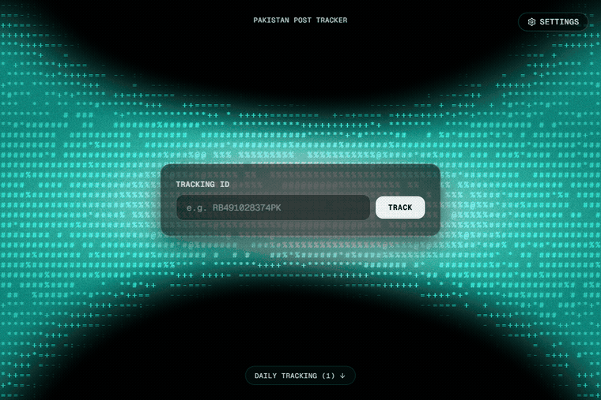
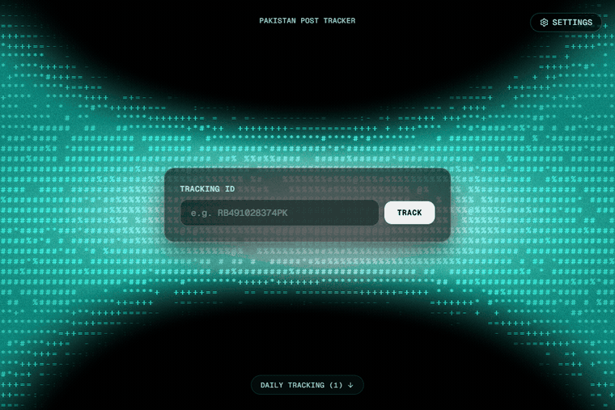
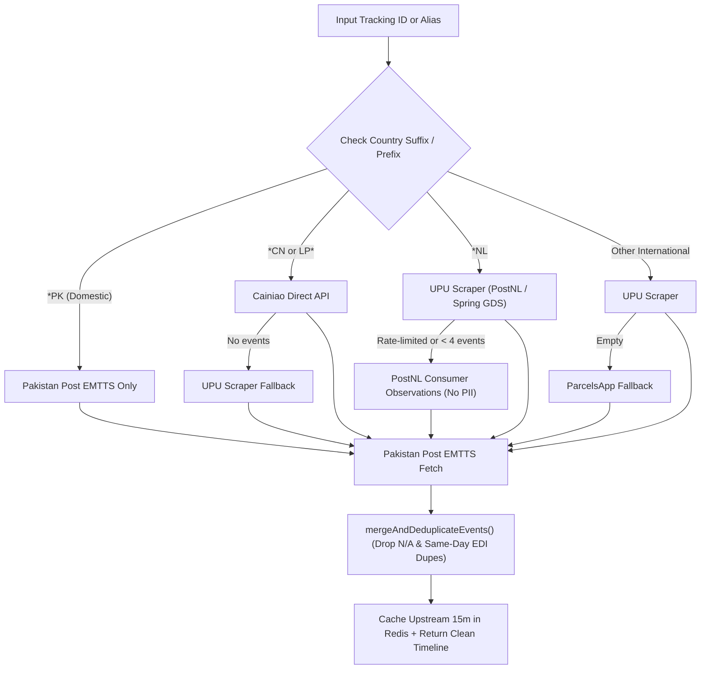
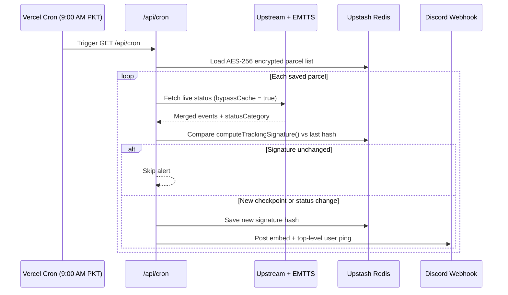

# Pakistan Post Tracker

A small Next.js parcel tracker I built so I do not have to keep checking `ep.gov.pk` and foreign carrier sites by hand every day. It tracks shipments across origin carriers and Pakistan Post EMTTS and sends a Discord ping at 9:00 AM PKT only when something actually moves.

Live demo: [pakpost-track.vercel.app](https://pakpost-track.vercel.app)

---

## Why I built this

Checking international mail coming into Pakistan is annoying for two reasons:

1. Pakistan Post EMTTS (`ep.gov.pk`) barely shows anything until the parcel physically lands in Pakistan or gets an EDI scan.
2. Third-party tracking aggregators scrape different sources on every refresh so you get duplicate checkpoints or broken `N/A` timestamps and if you automate a daily check without diffing it just spams Discord with the exact same status every morning.

So I wanted one place where I can type a tracking ID once add it to a daily list behind a passcode and forget about it until Discord pings me.

---

## Real interactions

### Searching a parcel and browsing checkpoints
Typing a sample ID like `CP123456789PK` runs a live lookup against Pakistan Post and renders the checkpoint timeline inside the frosted card with smooth wheel scrolling.



### Daily list privacy and passcode protection
Saved parcels show up masked (`LT••••••NL`) using HMAC aliases so public visitors never see real tracking numbers. Adding deleting or opening cron and webhook settings requires an owner passcode.



---

## How it decides where to check

Instead of firing requests at four scrapers at once and taking whichever responds first `lib/upstream.ts` routes by tracking prefix and merges upstream scans with Pakistan Post EMTTS inside `lib/pakpost.ts`. Undated `N/A` entries and duplicate same-day EDI lines get dropped before sorting by PKT time.



---

## Daily Discord alerts (change-only)

Vercel Cron triggers `/api/cron` every day at `04:00 UTC` (`09:00 AM PKT` via `vercel.json`). It bypasses the 15-minute cache fetches fresh scans builds a state signature and compares it against the last saved signature in Upstash Redis.



---

## Privacy and storage

- Tracking IDs webhook URL and cron schedule are encrypted with `AES-256-GCM` (`lib/crypto.ts`) before being stored in Upstash Redis.
- Public API calls receive masked IDs (`LT••••••NL`) and 16-char HMAC-SHA256 aliases instead of raw tracking numbers.
- Owner actions (`add` `remove` `settings`) check `SETTINGS_PASSCODE` server-side through `/api/auth/verify` and `/api/parcels`.
- When hitting PostNL's consumer endpoint as a 429 fallback only observation dates and status text are read so recipient address fields never leave the origin response.

---

## API routes

| Route | Method | What it does |
|---|---|---|
| `/api/track` | `GET`, `POST` | Tracks by raw `id` or opaque `alias` and masks responses for saved parcels |
| `/api/parcels` | `GET`, `POST` | Returns masked public parcels or modifies tracked items and settings with passcode |
| `/api/cron` | `GET`, `POST` | Runs daily check with diff detection and posts Discord updates |
| `/api/notify-test` | `POST` | Sends a test Discord embed with user mention |
| `/api/auth/verify` | `POST` | Checks owner passcode before editing |

---

## Setup and deployment

### 1. Environment variables

Copy `.env.example` to `.env.local` for local runs or add these in your Vercel project settings:

```env
DISCORD_WEBHOOK_URL=https://discord.com/api/webhooks/WEBHOOK_ID/WEBHOOK_TOKEN
DISCORD_PING_USER_ID=YOUR_DISCORD_USER_ID
TRACKING_IDS=CP123456789PK:Sample Parcel
UPSTASH_REDIS_REST_URL=https://your-redis.upstash.io
UPSTASH_REDIS_REST_TOKEN=your_upstash_token
ENCRYPTION_KEY=random_32_byte_secret
SETTINGS_PASSCODE=your_owner_passcode
CRON_SECRET=optional_cron_secret
```

### 2. Run locally

```bash
npm install
npm run dev
```

Open `http://localhost:3000`.

### 3. Deploy to Vercel

Push to GitHub and import the repo into Vercel with the environment variables above. `vercel.json` handles the daily `0 4 * * *` cron job automatically.

---

## License

MIT
