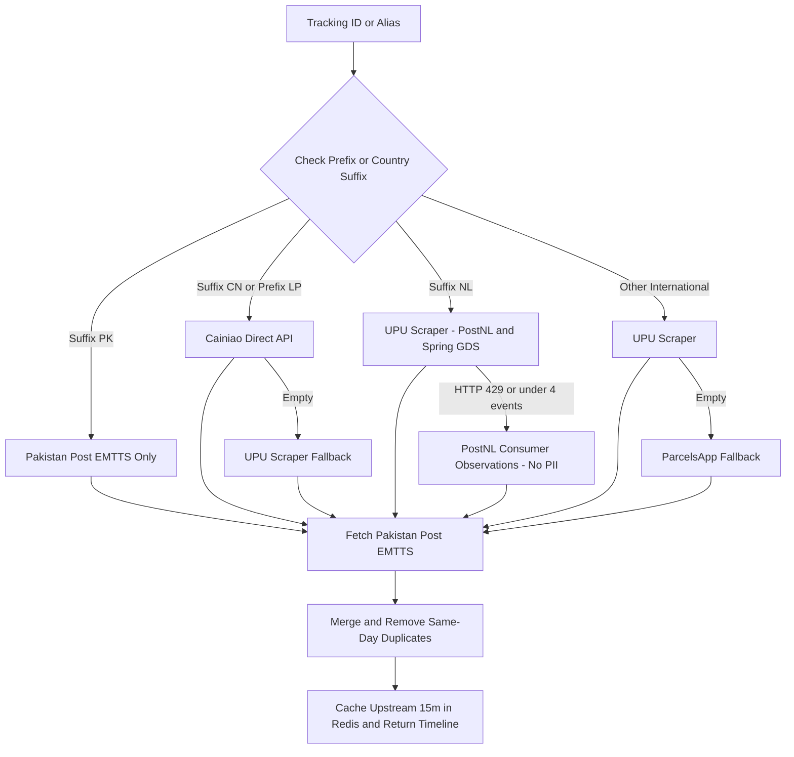
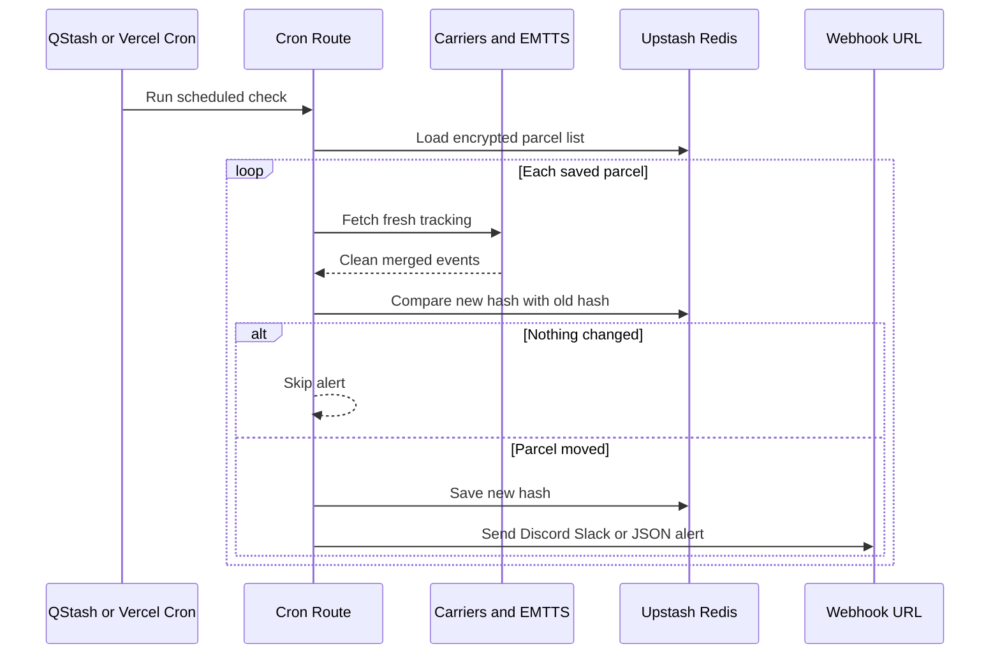

# Pakistan Post Tracker

A Next.js parcel tracker for Pakistan Post and international shipments that watches your parcels and sends an alert only when something actually moves.

Live: [pakpost-track.vercel.app](https://pakpost-track.vercel.app)

---

## Why I made this

Checking `ep.gov.pk` every day gets old fast. Half the time nothing shows up until the parcel lands in Pakistan and most third-party sites jump between different trackers every refresh so you see duplicate events or missing `N/A` dates. On top of that a basic daily cron job just spams Discord with the same message every morning even when nothing changed.

So I made a clean dashboard where you track a parcel once put it on a daily watchlist behind a passcode and only get pinged when a new checkpoint shows up. Anyone can also fork it with their own password or hit `/api/track` directly as a JSON API for Telegram bots Slack scripts or shortcuts.

---

## Demo

Typing a sample ID (`CP123456789PK`) and scrolling through checkpoints:

Daily watchlist with hidden IDs (`LT••••••NL`) passcode check and Settings:

---

## How it checks carriers

Instead of scraping four sites at random `lib/upstream.ts` picks one path based on the tracking number prefix or country code. Then `lib/pakpost.ts` combines that with Pakistan Post EMTTS drops `N/A` rows removes duplicate same-day scans and caches the upstream response for 15 minutes in Redis.

One small note on Netherlands parcels: `postnl.post` blocks shared server IPs after 20 requests a minute so it falls back to `jouw.postnl.nl` and reads only dates and status lines without pulling any personal address details.

---

## How daily checks and alerts work

Each scheduled run calls `/api/cron` skips the 15-minute cache fetches fresh scans and saves a signature hash in Redis. If the parcel looks the same as yesterday it stays quiet. If something moved it sends the alert.

- If you add `QSTASH_TOKEN` changing the cron box inside Settings updates your live Upstash QStash schedule right away without redeploying.
- Without `QSTASH_TOKEN` it falls back to the static schedule in `vercel.json` (`0 4 * * *` which is 9:00 AM PKT).

---

## Using it with other apps (not just Discord)

You can use this for whatever setup you have:

- **As a tracking API:** Call `GET /api/track?id=CP123456789PK` from Python n8n Telegram bots Home Assistant or iOS Shortcuts to get clean JSON events back.
- **Slack or custom webhooks:** Paste any URL into **Webhook URL** in Settings (or `DISCORD_WEBHOOK_URL` in env). It checks the link and automatically sends either a Discord embed a Slack message or a plain JSON `POST` (`{ event, updatedCount, parcels }`).
- **Editing alert layout:** If you want to change what Discord embeds or Slack alerts look like everything is in `lib/webhook-templates.ts`.

---

## Endpoints

| Route | What you pass | What it returns |
|---|---|---|
| `GET /api/track` | `?id=` or `?alias=` | Clean JSON timeline (masks IDs that belong to your daily list) |
| `GET /api/parcels` | optional `?passcode=` | Masked IDs and aliases for public users or full IDs with passcode |
| `POST /api/parcels` | `{ passcode, action, ... }` | Add/remove parcels or update schedule webhook and passcode |
| `GET \| POST /api/cron` | `?force=true` `&notify=false` `&secret=` | Runs diff check on all saved parcels (`force=true` alerts even if unchanged) |
| `POST /api/notify-test` | optional `{ webhookUrl }` | Sends a test message to verify your webhook |
| `POST /api/auth/verify` | `{ passcode }` | Checks your owner passcode |

---

## Setting up your own copy

1. Fork or clone this repo and deploy it to **Vercel**.
2. Attach **Upstash Redis** from the Vercel Marketplace (or create a free one at Upstash) for `UPSTASH_REDIS_REST_URL` and `UPSTASH_REDIS_REST_TOKEN` (`KV_REST_API_*` works too).
3. If you want to change the cron schedule right from Settings without redeploying also attach **Upstash QStash** (`QSTASH_TOKEN` and `QSTASH_URL`).
4. Add your variables in Vercel and redeploy once:

| Variable | What it does |
|---|---|
| `UPSTASH_REDIS_REST_URL` / `UPSTASH_REDIS_REST_TOKEN` | Stores your encrypted parcels webhook and hashes (`KV_REST_API_*` works too) |
| `SETTINGS_PASSCODE` | Your password to open Settings and add or delete parcels (you can change it later inside Settings too) |
| `CRON_SECRET` | Secures `/api/cron` and encrypts stored data (`ENCRYPTION_KEY` can also be set separately if you want) |
| `QSTASH_TOKEN` / `QSTASH_URL` | Optional Upstash QStash credentials so changing schedule inside Settings updates live without redeploying |
| `DISCORD_WEBHOOK_URL` | Optional default Discord Slack or JSON webhook URL |
| `DISCORD_PING_USER_ID` | Optional Discord user ID if you want Discord alerts to ping you |
| `TRACKING_IDS` | Optional starter list like `CP123456789PK:Sample` |

Once deployed click **Settings** in the top right enter your `SETTINGS_PASSCODE` and set your webhook or schedule (`0 4 * * *` UTC or `CRON_TZ=Asia/Karachi 0 9 * * *`).
