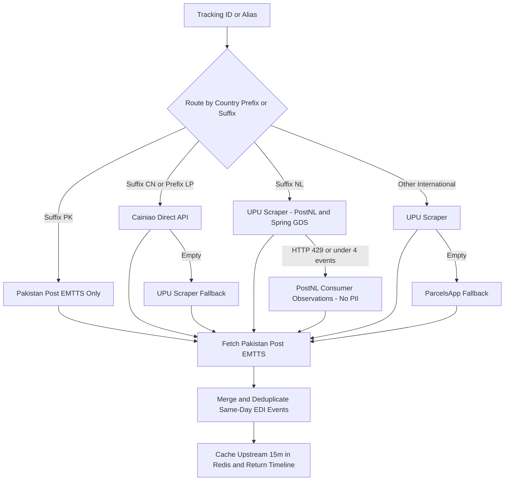
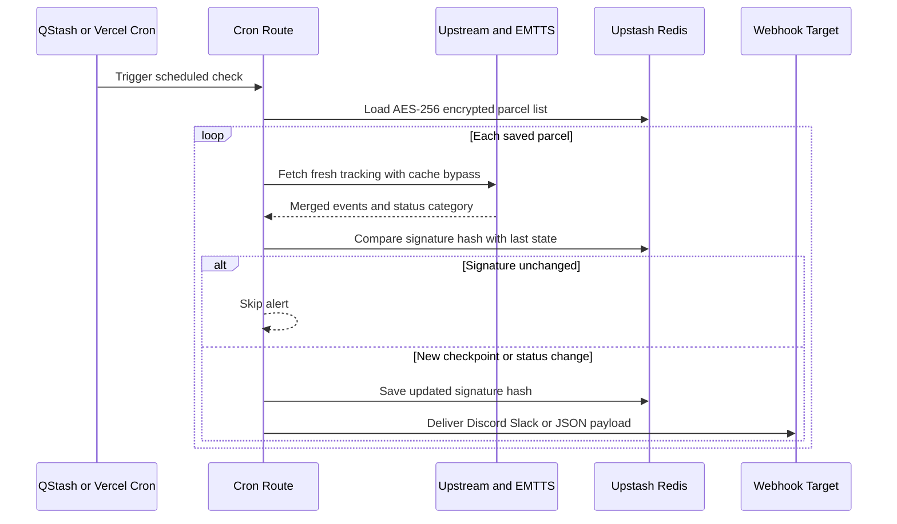

# Pakistan Post Tracker

Self-hostable Next.js tracker and REST API for Pakistan Post EMTTS plus incoming international carriers (`PostNL` `Cainiao` `UPU` `ParcelsApp`). Built to send change-only alerts to Discord Slack or any custom webhook without leaking saved tracking numbers.

Live instance: [pakpost-track.vercel.app](https://pakpost-track.vercel.app)

---

## Problems this solves

1. `ep.gov.pk` shows little or nothing before an international parcel reaches Pakistan.
2. Tracking sites switch scrapers across refreshes leaving duplicate checkpoints or broken `N/A` timestamps.
3. Naive cron jobs ping Discord every single run even when nothing moved.
4. Hosting a personal list publicly usually exposes raw tracking numbers unless they are encrypted and masked server-side.

---

## Demo

Sample lookup (`CP123456789PK`) and timeline scrolling:


Masked daily list (`LT••••••NL`) passcode modal and settings:


---

## Carrier routing and deduplication

`lib/upstream.ts` picks the upstream carrier by tracking prefix or country suffix instead of racing every scraper on every request. `lib/pakpost.ts` merges those scans with Pakistan Post EMTTS strips undated `N/A` rows removes duplicate same-day EDI records and caches the upstream manifest for 15 minutes in Redis.



`postnl.post` throws HTTP `429` at `20 req/min` on shared Vercel IPs so `jouw.postnl.nl` acts as fallback while discarding every field except `observationDate` and `description` so recipient address PII never leaves the origin fetch.

---

## Scheduling and change-only alerts

Every scheduled run hits `/api/cron` bypasses the 15-minute cache fetches fresh carrier events builds a signature (`statusCategory:totalEvents:latestEvent`) and only fires the configured webhook if that hash changed.

- **With `QSTASH_TOKEN` set:** Editing the cron field in Settings syncs a live **Upstash QStash** schedule immediately with zero redeploy (`0 4 * * *` UTC or `CRON_TZ=Asia/Karachi 0 9 * * *`).
- **Without `QSTASH_TOKEN`:** `vercel.json` runs statically as a daily fallback (`0 4 * * *`).



---

## Use it as an API or connect other services

You do not need Discord to use this.

### 1. Standalone tracking JSON endpoint
Hit `GET /api/track?id=CP123456789PK` from scripts Telegram bots Home Assistant n8n or iOS Shortcuts to get normalized PKT events across origin carriers + EMTTS.

### 2. Multi-service webhook auto-detection
Paste any destination URL into **Webhook URL** inside Settings (or `DISCORD_WEBHOOK_URL` in env):
- `discord.com/api/webhooks/...` sends rich Discord embeds plus optional `<@DISCORD_PING_USER_ID>` mention.
- `hooks.slack.com/...` sends a formatted Slack message.
- Any other `https://...` URL receives a raw JSON `POST`:

```json
{
  "event": "parcel_update",
  "source": "pakpost-tracker",
  "checkedAt": "2026-11-11T18:00:00.000Z",
  "updatedCount": 1,
  "parcels": [ ... ]
}
```

To customize Discord embeds Slack formatting or JSON webhook payloads edit `lib/webhook-templates.ts`.

---

## API endpoints

| Endpoint | Params / Body | Behavior |
|---|---|---|
| `GET /api/track` | `?id=` or `?alias=` plus optional `&label=` | Resolves parcel merges upstream + EMTTS and masks saved parcel IDs |
| `POST /api/track` | `{ id, alias, label }` | JSON body equivalent of `GET /api/track` |
| `GET /api/parcels` | optional `?passcode=` | Public callers receive masked IDs (`LT••••••NL`) + 16-char HMAC aliases; valid passcode returns raw list |
| `POST /api/parcels` | `{ passcode, action: add \| remove \| settings, ... }` | Mutates Redis state (`403` invalid passcode `503` if `SETTINGS_PASSCODE` unset) |
| `GET \| POST /api/cron` | `?force=true` `&notify=false` `&secret=` | Runs live diff check across saved parcels; accepts `Authorization: Bearer <CRON_SECRET>` |
| `POST /api/notify-test` | optional `{ webhookUrl }` | Sends a test payload matching Discord Slack or generic JSON |
| `POST /api/auth/verify` | `{ passcode }` | Verifies owner passcode |

---

## Self-hosting and environment variables

No default password ships in the codebase. Set `SETTINGS_PASSCODE` and Redis credentials before deploying your fork:

| Variable | Purpose |
|---|---|
| `UPSTASH_REDIS_REST_URL` / `UPSTASH_REDIS_REST_TOKEN` | Encrypted Redis store (`KV_REST_API_*` and `STORAGE_*` from Vercel Storage also supported) |
| `SETTINGS_PASSCODE` | Initial owner passcode for Settings and daily list changes (can be changed later inside Settings via salted `scrypt` hash in Redis `pakpost:enc:passcode`) |
| `ENCRYPTION_KEY` | Seed key for `AES-256-GCM` Redis entries (`pakpost:enc:*`); falls back to `CRON_SECRET` if omitted |
| `CRON_SECRET` | Secures `/api/cron` via `Bearer` token or `?secret=` and salts HMAC aliases |
| `QSTASH_TOKEN` | Enables live schedule editing straight from the Settings panel via Upstash QStash |
| `DISCORD_WEBHOOK_URL` | Default Discord Slack or JSON webhook URL |
| `DISCORD_PING_USER_ID` | Optional numeric Discord user ID pinged on Discord alerts |
| `TRACKING_IDS` | Optional fallback seed (`ID:Label,ID2:Label2`) if Redis has no saved list |
