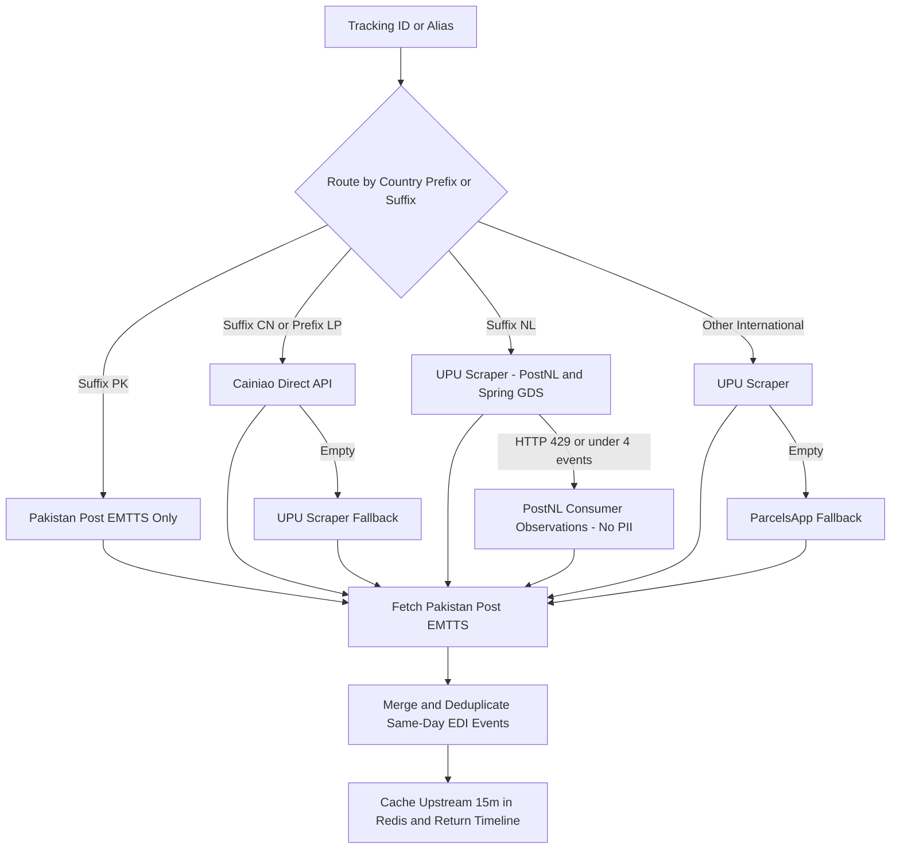
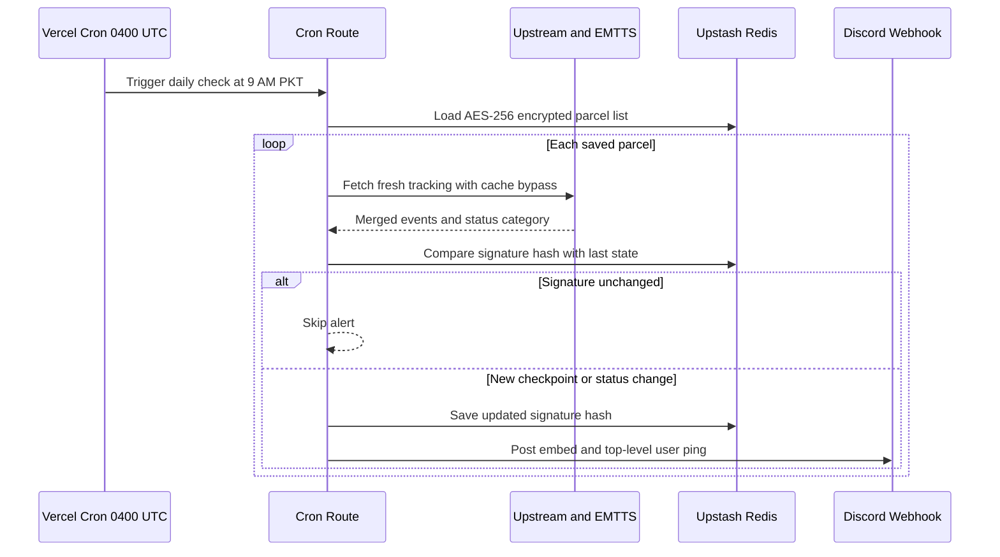

# Pakistan Post Tracker

Tracks domestic and incoming international parcels across origin carriers and Pakistan Post EMTTS then pings Discord at 9:00 AM PKT only when a shipment moves.

Live: [pakpost-track.vercel.app](https://pakpost-track.vercel.app)

---

## Why I built this

Checking incoming mail on `ep.gov.pk` gets annoying fast:

1. EMTTS stays blank or shows little before a parcel lands in Pakistan.
2. Public multi-tracker sites jump between scrapers on every refresh leaving duplicate lines or broken `N/A` timestamps.
3. Basic cron bots spam the exact same status in Discord every morning.

So I put together one Next.js app that routes each parcel to the right carrier picks clean PKT timestamps saves tracking IDs encrypted behind a passcode and only sends a Discord ping when the state hash changes.

---

## Demo

Sample tracking lookup (`CP123456789PK`) and timeline scrolling:

Masked daily list (`LT••••••NL`) passcode guard and locked settings:

---

## Carrier routing and deduplication

`lib/upstream.ts` picks the upstream source by tracking prefix or country suffix instead of racing every aggregator at once. `lib/pakpost.ts` merges those scans with Pakistan Post EMTTS drops undated `N/A` entries deduplicates same-day EDI records and caches the upstream result for 15 minutes.

Note on PostNL fallback: `postnl.post` throws HTTP `429` at `20 req/min` on shared Vercel IPs so `jouw.postnl.nl` acts as fallback while stripping everything except `observationDate` and `description` so recipient address fields never enter the app.

---

## Daily Discord cron and diffing

`vercel.json` runs `/api/cron` daily at `04:00 UTC` (`09:00 AM PKT`). Cron bypasses the 15-minute cache fetches fresh carrier events builds a signature via `computeTrackingSignature` (`statusCategory:totalEvents:latestEvent`) and compares it to the previous hash in Redis.

---

## Endpoints and flags

| Endpoint | Params / Body | Behavior |
|---|---|---|
| `GET /api/track` | `?id=` or `?alias=` and optional `&label=` | Resolves parcel merges upstream + EMTTS and masks saved parcel IDs in output |
| `POST /api/track` | `{ id, alias, label }` | JSON body equivalent of `GET /api/track` |
| `GET /api/parcels` | optional `?passcode=` | Public visitors get masked IDs (`LT••••••NL`) + 16-char HMAC aliases; valid passcode returns full list |
| `POST /api/parcels` | `{ passcode, action: add \| remove \| settings, ... }` | Mutates AES-256 encrypted Redis state (`403` on bad passcode) |
| `GET \| POST /api/cron` | `?force=true` `&notify=false` `&secret=` | Checks all saved parcels live; `?force=true` pushes even without status change; accepts `Authorization: Bearer` header |
| `POST /api/notify-test` | optional `{ webhookUrl }` | Fires a test Discord embed with user ping |
| `POST /api/auth/verify` | `{ passcode }` | Verifies owner passcode against `SETTINGS_PASSCODE` |

---

## Storage and security notes

- **Redis keys** (`lib/config.ts`): `pakpost:enc:parcels` `pakpost:enc:webhook` `pakpost:enc:schedule` (`AES-256-GCM` in `iv:authTag:ciphertext` format) plus `pakpost:enc:signatures` (diff hashes) and `pakpost:cache:v3:upstream:<id>` (`900s` TTL).
- **Privacy masking**: Saved tracking IDs are replaced with `XX••••••YY` and mapped to HMAC-SHA256 aliases (`generateAlias`) so client requests never expose real numbers.
- **Cron schedule caveat**: Changing cron inside Settings updates Redis metadata and local `vercel.json` when running locally. On Vercel production the actual run time stays tied to `vercel.json` until committed and redeployed.

---

## Environment variables

| Variable | Purpose |
|---|---|
| `UPSTASH_REDIS_REST_URL` / `UPSTASH_REDIS_REST_TOKEN` | Redis persistence (`KV_REST_API_*` and `STORAGE_*` from Vercel Storage also supported) |
| `DISCORD_WEBHOOK_URL` | Fallback webhook URL if not saved in Settings |
| `DISCORD_PING_USER_ID` | Numeric Discord user ID pinged in `content` and `allowed_mentions` |
| `SETTINGS_PASSCODE` | Owner passcode required to add delete or edit settings |
| `ENCRYPTION_KEY` | Key seed for `AES-256-GCM` encryption in Redis |
| `CRON_SECRET` | Protects `/api/cron` via `Bearer` token or `?secret=` and salts HMAC aliases |
| `TRACKING_IDS` | Optional fallback seed (`ID:Label,ID2:Label2`) when Redis has no list saved |
